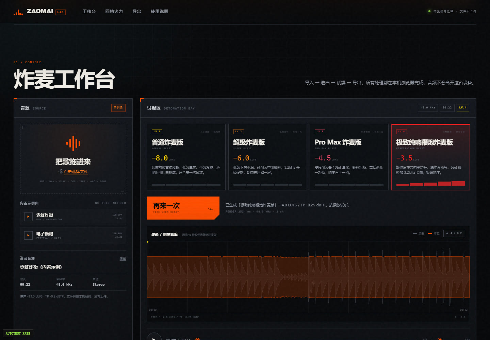
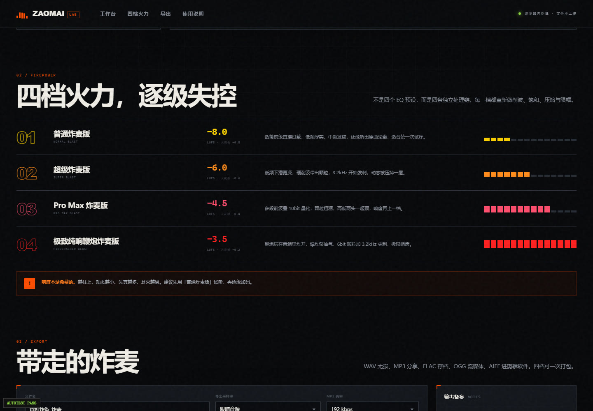

# 炸麦实验室 · ZAOMAI LAB

一个**纯静态、纯浏览器**的炸麦音乐生成器。把歌拖进去，选一档火力，直接在本地生成并导出成品。

四档：

- **普通炸麦版** · NORMAL BLAST
- **超级炸麦版** · SUPER BLAST
- **Pro Max 炸麦版** · PRO MAX BLAST
- **极致纯响鞭炮炸麦版** · FIRECRACKER BLAST

没有后端、没有上传、没有登录。双击 `index.html` 就能用。





---

## 1. 立即使用

1. 双击 `index.html`，用 **Chrome / Edge** 打开（推荐 120+）。
2. 拖入一首歌，或点内置示例曲「霓虹炸街 / 电子鞭炮」。
3. 点一档炸麦，按「开始炸麦」渲染。
4. 用 A/B 对比原曲与成品，确认后选择格式导出。

不需要安装依赖，不需要起服务器，也不依赖 ffmpeg。所有 DSP 和编码都在浏览器里完成。

> 第一次播放会弹出听力安全提示。默认音量 32%，请先把系统音量调低。

---

## 2. 四档火力

| 档位 | 目标响度 | 真峰值上限 | 听感 | 主要处理 |
|---|---:|---:|---|---|
| 普通炸麦版 | -8.0 LUFS | -0.8 dBTP | 低频轰鸣、硬削波颗粒、3kHz 发刺，保留最多动态 | zaomai 基础链：低切、70/200Hz 提升、15dB 推子、硬削波、3.2kHz 激励、压缩、限幅 |
| 超级炸麦版 | -6.0 LUFS | -0.6 dBTP | 更深的低频、更硬的削波、空气感更强 | 18dB 推子、更低的削波阈值、tanh 饱和、9kHz 空气感、8:1 压缩 |
| Pro Max 炸麦版 | -4.5 LUFS | -0.4 dBTP | 颗粒更粗、边缘更硬，为手机外放/短视频特化 | 21dB 推子、10-bit 量化、双重削波、12:1 压缩 |
| 极致纯响鞭炮炸麦版 | -3.5 LUFS | -0.2 dBTP | 最响、最碎、最失控；音乐里叠合成鞭炮层 | 26dB 推子、6-bit 碎化 + sample-hold、鞭炮瞬态层、16:1 压缩、真峰值限幅 |

目标响度是**归一化目标**。实际输出会受素材动态和真峰值上限影响，通常有 ±0.8 dB 偏差；页面里的 HUD 显示的是实测值。四档保证严格递进，越往上越响、动态越小。

> 响度不是免费的。越往上，失真越多、耳朵越累。建议先用普通炸麦版试听。

---

## 3. 支持哪些输入

- **拖拽**音频到左侧投放区，或点击选择文件。
- 常见浏览器可解码的格式：MP3、WAV、FLAC、OGG / OGA、M4A、AAC、Opus、AIFF / AIF、WebM。
- 实际支持范围取决于浏览器的 `decodeAudioData`；Chrome / Edge 覆盖最全，Safari 对 OGG/Opus 等格式可能不支持。
- 单文件上限 **300 MB**，时长上限 **10 分钟**；超过 3 分钟的素材不会自动渲染，需要手动点「开始炸麦」。
- 内置两首实时合成示例曲（48kHz 立体声）：
  - 霓虹炸街 · 128 BPM · 22.5s · EDM 四踩
  - 电子鞭炮 · 150 BPM · 19.2s · 电子锣鼓 + 合成鞭炮

音频只在当前标签页的内存里解码，不会发到任何服务器。

---

## 4. 支持哪些输出

页面提供 **7 种导出格式**：

| 格式 | 参数 | 说明 |
|---|---|---|
| WAV 16-bit | PCM s16le | 通用无损，兼容性最好 |
| WAV 24-bit | PCM s24le | 高精度无损，适合继续后期 |
| WAV 32-bit Float | IEEE float | 给后期软件留余量 |
| MP3 | 128 / 192 / 320 kbps | 兼容性最好，有损；浏览器内用 lamejs 编码 |
| FLAC 16-bit | 原生 FLAC | 无损压缩，逐样本还原 |
| OGG Opus | 128 kbps（当前 UI 固定；编码器支持 96 / 128 / 192） | 流媒体友好；需要 Chromium 的 WebCodecs Opus 编码器，不支持时按钮会置灰 |
| AIFF 16-bit | PCM s16be | macOS / 视频剪辑软件 |

采样率可选：

- **跟随音源**（默认）
- **44.1 kHz**
- **48 kHz**

MP3 / OGG 最高按 48 kHz 输出，避免编码器不支持更高采样率。

### 单档导出

选格式 → 点「导出当前档」。文件名自动使用「音源名_档位名」，可手动改前缀。

### 四档 ZIP

「四档打包 ZIP」会把**当前所选格式/采样率**下的四档成品、`四档对比.png`、`炸麦说明.txt` 一起打包。默认格式是 WAV 16-bit；如果先选了 MP3，就会打包四档 MP3。

### 四档对比图

「导出对比图 PNG」生成 1600×1200 的对比报告：原曲波形 + 四档波形 + 每档 LUFS / 真峰值 / RMS / 动态 / 处理耗时。

---

## 5. 工作原理

整个处理链是**纯 JavaScript 采样级 DSP**，不依赖 Web Audio 节点图或后端：

```
decodeAudioData
  → 高通 / 低架 / 峰值 EQ
  → drive 推子
  → 硬削波 + tanh 饱和
  → bit-crush / sample-hold（Pro Max、鞭炮版）
  → 鞭炮瞬态合成层（仅鞭炮版）
  → 压缩 / 限幅
  → BS.1770-4 响度测量 + 4× 真峰值估计
  → 迭代归一化到目标 LUFS，且不超过真峰值上限
```

导出器同样在浏览器内完成：

- WAV / AIFF：自写 RIFF / AIFF 封装，16/24/32f 与 16-bit big-endian
- FLAC：自写原生 FLAC 编码器（fixed blocksize、CRC、STREAMINFO、VORBIS_COMMENT）
- MP3：vendor 内的 lamejs（LAME 3.98.4）
- OGG Opus：WebCodecs `AudioEncoder` + 自写 Ogg 封装（含 OpusHead / OpusTags / granulepos）
- ZIP：自写 store 模式 ZIP，支持异步读取 canvas PNG 与文本 Blob

采样率转换使用浏览器的 `OfflineAudioContext`。

---

## 6. 文件结构

```
zaomai-studio/
├─ index.html                 页面结构
├─ styles.css                 工业霓虹风样式与响应式
├─ src/
│  ├─ app.js                  UI 控制器、播放、导出流程
│  ├─ dsp.js                  四档 DSP、BS.1770-4 测量、归一化
│  ├─ exporters.js            WAV/MP3/FLAC/OGG/AIFF/ZIP 编码
│  └─ demo-track.js           两首内置示例曲的实时合成
├─ vendor/
│  ├─ lame.min.js             lamejs / LAME 3.98.4（LGPL-3.0）
│  ├─ COPYING.LESSER          LGPL-3.0 全文
│  └─ README.md               第三方组件来源与指纹
├─ assets/                    示例曲的预渲染 WAV（测试/试听用）
├─ docs/
│  ├─ CONTRACT.md             模块接口契约
│  └─ screenshots/            页面截图
├─ test/                      自动化测试与 CDP 验收脚本
├─ README.md
└─ THIRD_PARTY_NOTICES.md
```

页面用 classic script 顺序加载，没有构建步骤：

```html
vendor/lame.min.js → src/dsp.js → src/exporters.js → src/demo-track.js → src/app.js
```

---

## 7. 调试与自动化

页面内置两个自测入口：

- `index.html?autotest=1`：载入「霓虹炸街」，自动跑当前档并写入 `window.__AUTOTEST__`
- `index.html?autotest=full`：跑完四档并验证 WAV16 / MP3 / FLAC（可选 OGG）编码

控制台可用 `window.ZaomaiApp`：

```js
ZaomaiApp.getPresets()
ZaomaiApp.getFormats()
ZaomaiApp.loadDemo('neon-overdrive')
ZaomaiApp.selectPreset('firecracker')
await ZaomaiApp.processCurrent()
await ZaomaiApp.exportCurrent()
await ZaomaiApp.exportAll()
await ZaomaiApp.exportComparePng()
```

### Node 测试

需要 Node 18+；WAV 测试会调用 `ffmpeg/ffprobe`，ZIP 测试会调用 Python 3。

```bash
node test/dsp.test.cjs       # DSP / 响度 / 真峰值 / 四档递进，PASS 10/10
node test/export.test.cjs    # 7 种格式 + ZIP 结构，PASS 55/55
```

### 浏览器验收脚本（Windows + Chrome）

这些脚本硬编码了本机 Chrome 路径与项目路径，按需修改顶部常量：

```bash
node test/cdp-run.cjs                       # 跑 autotest 并截图
node test/capture-exports.cjs               # 导出 7 种格式，ffprobe 校验
node test/download-test.cjs                 # 真实下载四档 ZIP + 对比 PNG
node test/shots.cjs                         # 各区块截图（桌面 + 移动）
```

---

## 8. 已知限制

- **OGG Opus 只在支持 WebCodecs AudioEncoder 的 Chromium 系浏览器可用**；其他浏览器会把该格式置灰。MP3 / WAV / FLAC / AIFF 不受影响。
- 音频时长超过 10 分钟或文件超过 300 MB 会被拒绝；长音频更容易触发浏览器内存压力。
- 鞭炮版为了守住真峰值上限并保留瞬态，实测通常落在 **-4.0 LUFS 左右**，而不是精确 -3.5；这仍在设计容差内。
- 浏览器解码 M4A/AAC/Opus 的能力因平台而异；遇到无法解码时请先转成 WAV/MP3。
- 页面是静态文件，推荐用本地 HTTP 服务托管；直接 `file://` 打开也可用，但个别浏览器对本地文件的安全策略更严格。

---

## 9. 听力安全

输出是成品响度：**-8 到约 -4 LUFS**，远高于普通流媒体音乐。

- 先把系统音量调到最低，再逐步加大。
- 不要长时间戴耳机试听。
- 不要把导出文件再叠加播放器增益、再压限一次。
- 听力损伤是永久性的。

---

## 10. 许可

本项目代码未指定开源许可证。第三方组件 lamejs / LAME 遵循 **LGPL-3.0**，详见 [THIRD_PARTY_NOTICES.md](THIRD_PARTY_NOTICES.md) 与 `vendor/COPYING.LESSER`。

页面里的「炸麦」配方参考自 audio-edit 技能的 zaomai preset，并在此基础上扩展为四档递进处理链。
